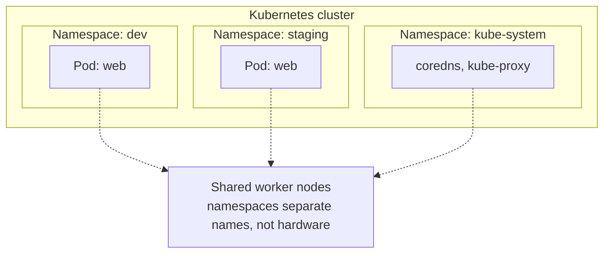

# 01 - Namespace

## The problem
Imagine one cluster shared by a **dev** team, a **QA** team and a **prod** workload.
Everyone creates a Deployment called `web`. The second `kubectl apply` silently
overwrites the first. Worse, a dev mistake can delete something production relies on.

## What it is
A **Namespace** is a virtual partition inside a cluster. Names only need to be unique
*within* a namespace, and you can attach access rules and resource limits per namespace.

Think of it as **folders on a shared drive**.

## Architecture

Namespaces are separate name scopes inside one shared cluster.



## Files
| File | What it shows |
|------|---------------|
| `namespaces.yaml` | Creates `dev` and `staging` namespaces |
| `pod-in-namespace.yaml` | The same Pod name living in both namespaces |

## Try it
```bash
kubectl apply -f namespaces.yaml
kubectl apply -f pod-in-namespace.yaml

kubectl get namespaces
kubectl get pods -n dev
kubectl get pods -n staging
kubectl get pods -A            # all namespaces

# Set a default namespace for your session
kubectl config set-context --current --namespace=dev
```

## Clean up
```bash
kubectl delete -f .            # deleting a namespace deletes everything inside it
```

## Key takeaways
- Namespaces separate **names**, not hardware: Pods from different namespaces can share a node.
- Built-in ones: `default`, `kube-system` (cluster components), `kube-public`, `kube-node-lease`.
- Nodes and PersistentVolumes are **cluster-wide**, not namespaced.
