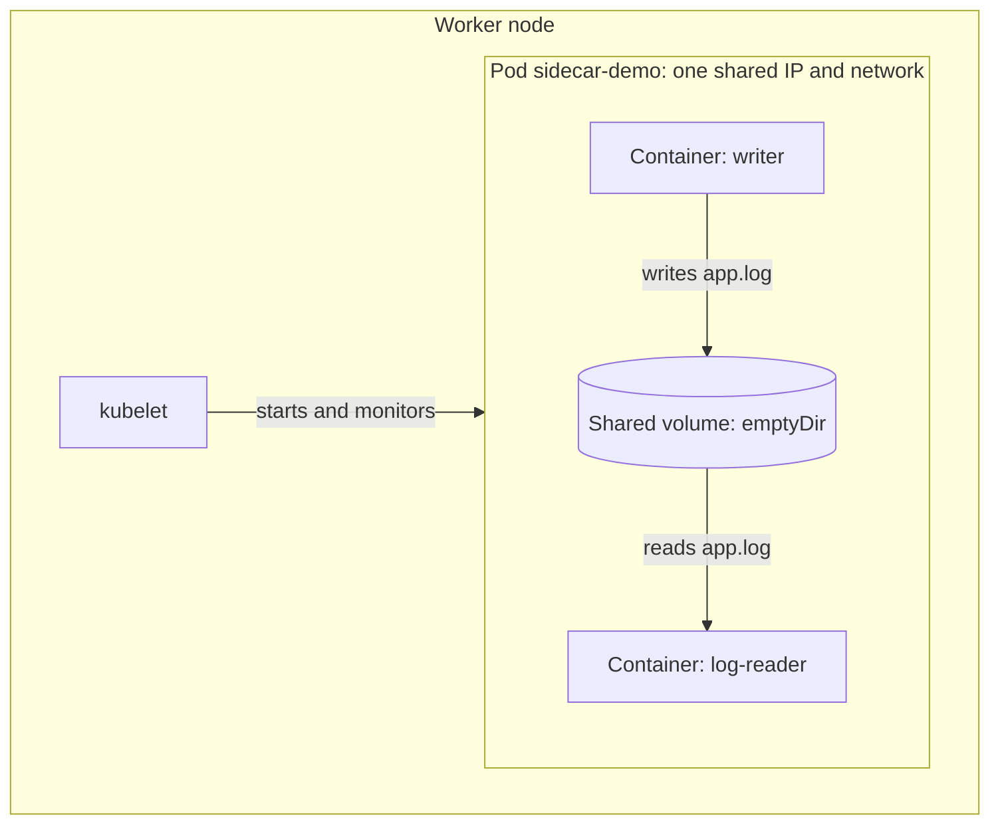

# 02 - Pod

## The problem
Kubernetes needs *something* to actually run your container on a machine.
But containers alone are not enough: sometimes two processes must run together,
share `localhost` and share files (an app plus a log shipper, for example).

## What it is
A **Pod** is the smallest deployable unit in Kubernetes. It wraps one or more
containers that:
- share one **IP address** and network (`localhost` works between them)
- can share **volumes**
- are always scheduled on the **same node**, and live and die together

Most Pods have **one** container. Extra containers are called *sidecars*.

## Architecture

A Pod wraps containers that share one IP, one network and optional volumes.



## Files
| File | What it shows |
|------|---------------|
| `pod-basic.yaml` | The simplest Pod: one nginx container |
| `pod-multi-container.yaml` | App + sidecar sharing a volume |
| `pod-with-probes.yaml` | Health checks: how Kubernetes knows the app is alive and ready |

## Try it
```bash
kubectl apply -f pod-basic.yaml
kubectl get pods -o wide
kubectl describe pod hello-pod
kubectl logs hello-pod
kubectl exec -it hello-pod -- sh
kubectl port-forward pod/hello-pod 8080:80     # open http://localhost:8080

kubectl apply -f pod-multi-container.yaml
kubectl logs sidecar-demo -c log-reader        # -c selects the container

kubectl apply -f pod-with-probes.yaml
kubectl describe pod probe-demo                # see Liveness/Readiness settings
```

## Experiment
```bash
kubectl delete pod hello-pod
kubectl get pods
```
The Pod is **gone for good**. Nobody recreates it. This is the problem the next
lesson (ReplicaSet) solves.

## Clean up
```bash
kubectl delete -f .
```

## Key takeaways
- Pods are **ephemeral**: they get new IPs when recreated.
- You rarely create bare Pods in real life; you use Deployments, which manage Pods for you.
- `requests` tell the scheduler what a Pod needs; `limits` cap what it may use.
