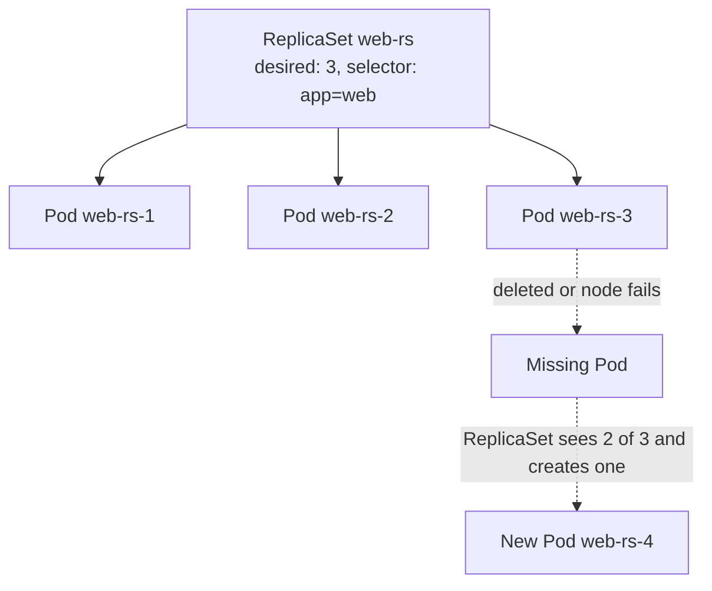

# 03 - ReplicaSet

## The problem
You created a Pod. The node crashes, or someone deletes the Pod, and your app is
**down**. Nothing brings it back. Also, one copy may not handle your traffic.

## What it is
A **ReplicaSet** keeps a stated number of identical Pods running at all times.
It runs a simple loop:

> "I want 3 Pods with label `app=web`. I see 2. Create 1 more."

It finds its Pods using a **label selector**, so labels must match between
`selector.matchLabels` and `template.metadata.labels`.

## Architecture

A ReplicaSet keeps the desired number of Pods running and replaces missing ones.



## Files
| File | What it shows |
|------|---------------|
| `replicaset.yaml` | 3 replicas of an nginx Pod |

## Try it
```bash
kubectl apply -f replicaset.yaml
kubectl get rs
kubectl get pods -o wide

# Self-healing: delete a Pod and watch a replacement appear
kubectl delete pod <one-pod-name>
kubectl get pods -w

# Scale
kubectl scale rs web-rs --replicas=5
kubectl get pods
```

## Clean up
```bash
kubectl delete -f replicaset.yaml
```

## Key takeaways
- ReplicaSet = **self-healing + scaling**, but it cannot do smart updates.
  If you change the image in the template, existing Pods are **not** replaced.
  That is why we use a **Deployment** (next lesson), which manages ReplicaSets for you.
- You will almost never create a ReplicaSet directly.
