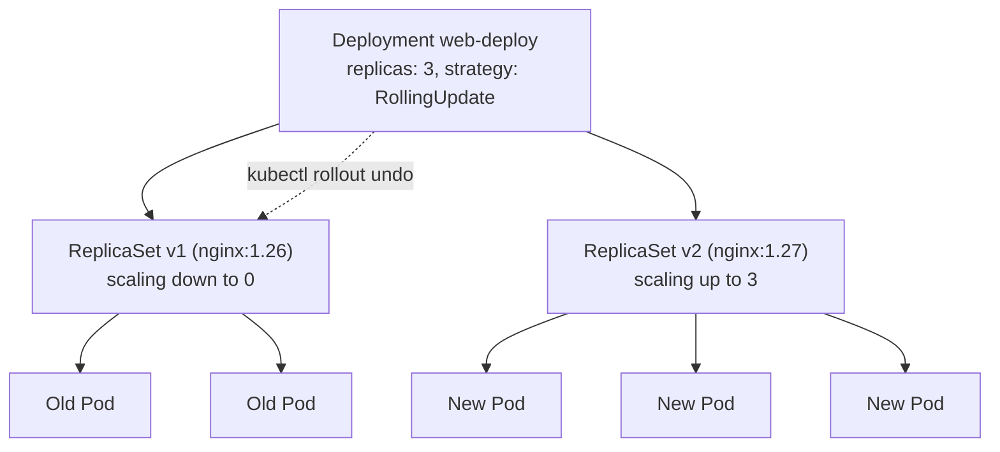

# 04 - Deployment

## The problem
You need to release version 2 of your app. With a ReplicaSet you would have to
delete every old Pod and create new ones, causing **downtime**. And if v2 is
broken, there is no easy way back.

## What it is
A **Deployment** manages ReplicaSets for you and adds:
- **Rolling updates**: replace Pods gradually, so some are always serving traffic
- **Rollbacks**: return to a previous version with one command
- **Revision history** of every change
- Scaling and self-healing (inherited from ReplicaSets)

```
Deployment  ->  ReplicaSet (v1)  ->  Pods
            ->  ReplicaSet (v2)  ->  Pods     (the new one scales up as the old one scales down)
```

## Architecture

A Deployment manages ReplicaSets, one per version, to roll out and roll back.



## Files
| File | What it shows |
|------|---------------|
| `deployment.yaml` | 3 replicas with a rolling-update strategy |

## Try it
```bash
kubectl apply -f deployment.yaml
kubectl get deploy,rs,pods

# Rolling update to a new image
kubectl set image deployment/web-deploy nginx=nginx:1.27
kubectl rollout status deployment/web-deploy
kubectl get rs                                   # old RS scaled to 0, new RS has 3

# Break it on purpose, then recover
kubectl set image deployment/web-deploy nginx=nginx:does-not-exist
kubectl get pods                                 # ImagePullBackOff, but old Pods still serve!
kubectl rollout history deployment/web-deploy
kubectl rollout undo deployment/web-deploy

# Scale
kubectl scale deployment web-deploy --replicas=5
```

## Clean up
```bash
kubectl delete -f deployment.yaml
```

## Key takeaways
- Use **Deployments** for stateless apps (web servers, APIs).
- `maxUnavailable` and `maxSurge` control how fast the rollout goes.
- Editing the YAML and re-running `kubectl apply` is the **declarative** way to update.
