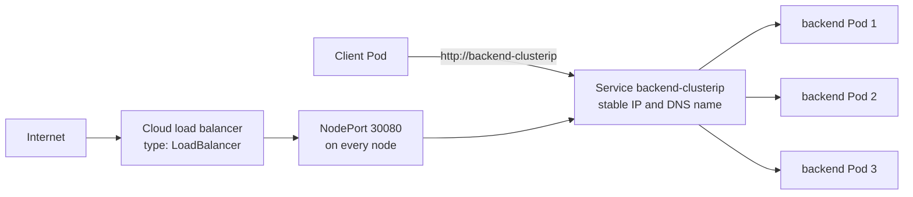

# 05 - Service

## The problem
Pods are **temporary**. Each time one is recreated it gets a **new IP**. If your
frontend hard-codes the backend Pod's IP, it breaks the moment that Pod restarts.
And with 3 backend replicas, which IP should the frontend call?

## What it is
A **Service** gives a set of Pods one **stable IP and DNS name**, and load-balances
traffic across the healthy ones. It finds Pods using a **label selector**.

| Type | Reachable from | Typical use |
|------|----------------|-------------|
| `ClusterIP` (default) | Inside the cluster only | Backend to backend calls |
| `NodePort` | Outside, via `<NodeIP>:<30000-32767>` | Quick demos, local clusters |
| `LoadBalancer` | Internet, via a cloud load balancer | Public apps on EKS/AKS/GKE |

## Architecture

A Service gives a changing set of Pods one stable address and load-balances across them.



## Files
| File | What it shows |
|------|---------------|
| `deployment.yaml` | The backend Pods the Services point at (uses a image that prints its Pod name) |
| `service-clusterip.yaml` | Internal-only access |
| `service-nodeport.yaml` | Access through a port on every node |
| `service-loadbalancer.yaml` | Public access through a cloud load balancer |

## Try it
```bash
kubectl apply -f deployment.yaml
kubectl apply -f service-clusterip.yaml

kubectl get svc
kubectl get endpoints backend-clusterip        # the Pod IPs behind the Service

# Call the Service from inside the cluster using its DNS name
kubectl run tmp --rm -it --image=busybox:1.36 --restart=Never -- \
  wget -qO- http://backend-clusterip
# Run it a few times: the Pod name changes = load balancing

# NodePort (works on minikube/kind/EKS nodes)
kubectl apply -f service-nodeport.yaml
minikube service backend-nodeport --url        # on minikube

# LoadBalancer (EKS creates an AWS load balancer; takes 2-3 minutes)
kubectl apply -f service-loadbalancer.yaml
kubectl get svc backend-lb -w
```

Use `kubectl port-forward svc/backend-clusterip 8080:80` when you just want to test from your laptop.

## Clean up
```bash
kubectl delete -f .
```
> On EKS, **delete LoadBalancer Services before deleting the cluster** so the AWS load balancer is removed.

## Key takeaways
- A Service only sends traffic to Pods that are **Ready** (readiness probe passes).
- Inside a cluster, use the DNS name: `<service>.<namespace>.svc.cluster.local`
  (or just `<service>` within the same namespace).
- `port` is the Service's port; `targetPort` is the container's port.
