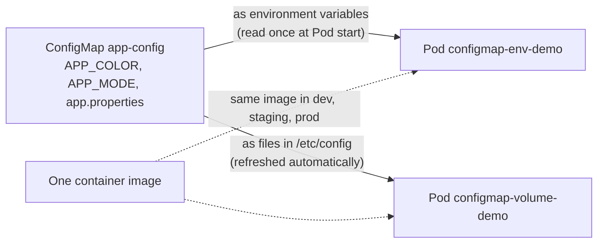

# 06 - ConfigMap

## The problem
Your app needs different settings per environment: a debug flag in dev, a different
API URL in prod. If you bake these into the container image you must **rebuild the
image for every environment**, and you can no longer promote the *same* image from
dev to prod.

## What it is
A **ConfigMap** stores non-sensitive configuration as key/value pairs (or whole files),
separately from the image. Pods consume it as:
1. **Environment variables**
2. **Files** mounted into the container

## Architecture

One image, many environments: configuration lives outside the image.



## Files
| File | What it shows |
|------|---------------|
| `configmap.yaml` | Simple keys plus a whole config file |
| `pod-env.yaml` | Pod reading ConfigMap values as environment variables |
| `pod-volume.yaml` | Pod reading the ConfigMap as files |

## Try it
```bash
kubectl apply -f configmap.yaml
kubectl apply -f pod-env.yaml
kubectl apply -f pod-volume.yaml

kubectl logs configmap-env-demo
kubectl logs configmap-volume-demo

# Change a value and see what happens
kubectl edit configmap app-config
kubectl logs configmap-volume-demo         # files update after ~1 minute (no restart needed)
kubectl delete pod configmap-env-demo && kubectl apply -f pod-env.yaml
kubectl logs configmap-env-demo            # env vars only change when the Pod restarts
```

## Clean up
```bash
kubectl delete -f .
```

## Key takeaways
- **Never** put passwords in a ConfigMap. Use a Secret (next lesson).
- Env vars are read **once at Pod start**; mounted files are refreshed automatically.
- Limit: 1 MiB per ConfigMap.
