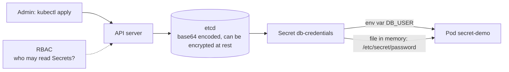

# 07 - Secret

## The problem
Your app needs a database password or an API key. Hard-coding it in the image or in a
ConfigMap means anyone who can read the YAML, the image, or the repository can see it.

## What it is
A **Secret** is like a ConfigMap meant for sensitive data. Kubernetes treats it more
carefully:
- It is not printed by `kubectl describe`
- Access can be limited with RBAC
- It can be encrypted at rest (on EKS, enable envelope encryption with KMS)
- It is delivered to Pods as env vars or files (files are held in memory, not on disk)

> **Important for students:** values are only **base64-encoded**, not encrypted.
> `echo c2VjcmV0 | base64 -d` reveals them. Real protection comes from RBAC,
> encryption at rest, and external tools (AWS Secrets Manager, Vault, External Secrets).

## Architecture

A Secret is stored by the API server, guarded by RBAC, and delivered to Pods as env vars or files.



## Files
| File | What it shows |
|------|---------------|
| `secret.yaml` | A Secret written with `stringData` (plain text; Kubernetes encodes it) |
| `pod-using-secret.yaml` | Reads the Secret as env var and as a file |

## Try it
```bash
kubectl apply -f secret.yaml
kubectl apply -f pod-using-secret.yaml
kubectl logs secret-demo

kubectl get secret db-credentials -o yaml          # values appear base64 encoded
kubectl get secret db-credentials -o jsonpath='{.data.password}' | base64 -d

# Create a secret without a YAML file
kubectl create secret generic api-key --from-literal=key=abc123
```

## Clean up
```bash
kubectl delete -f .
kubectl delete secret api-key
```

## Key takeaways
- **Do not commit real Secret YAML to Git.** This repo's values are fake demo values.
- Prefer mounting as files over env vars (env vars can leak in logs and crash dumps).
- Secrets and ConfigMaps are both namespaced and must be in the same namespace as the Pod.
