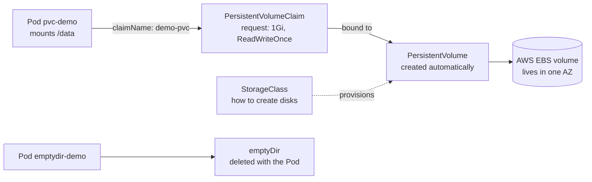

# 08 - Volumes, PersistentVolume (PV) and PersistentVolumeClaim (PVC)

## The problem
A container's filesystem is **wiped** every time the container restarts. If your database
writes to its own filesystem, all the data is lost on the next crash or redeploy.

## What it is
| Object | Analogy | Meaning |
|--------|---------|---------|
| **Volume** (`emptyDir`) | A scratch pad | Lives as long as the **Pod**; survives container restarts |
| **PersistentVolume (PV)** | A real disk in the datacenter | Actual storage (e.g. an AWS EBS volume) |
| **PersistentVolumeClaim (PVC)** | A request for a disk | "I need 1 GiB, read-write" |
| **StorageClass** | The disk catalog | Describes *how* to create disks (gp3, SSD, etc.) |

Developers ask for storage with a **PVC**; Kubernetes finds or **dynamically creates**
a PV through the StorageClass. The app never needs to know about EBS details.

## Architecture

A Pod asks for storage with a PVC; the StorageClass creates the real disk behind it.



## Files
| File | What it shows |
|------|---------------|
| `pod-emptydir.yaml` | Data survives a container restart but not Pod deletion |
| `pvc.yaml` | Asking for 1 GiB of storage |
| `pod-with-pvc.yaml` | Pod writing to the claimed disk |

## Prerequisites
A default StorageClass. Check: `kubectl get storageclass`.
On **EKS**, install the **Amazon EBS CSI driver** add-on first, otherwise the PVC stays `Pending`.

## Try it
```bash
# Part 1: emptyDir
kubectl apply -f pod-emptydir.yaml
kubectl exec emptydir-demo -- cat /data/hello.txt

# Part 2: persistent storage
kubectl apply -f pvc.yaml
kubectl get pvc                                  # Pending or Bound (depends on StorageClass)
kubectl apply -f pod-with-pvc.yaml
kubectl get pvc,pv                               # now Bound, and a PV was created
kubectl exec pvc-demo -- cat /data/hello.txt

# Prove persistence: delete the Pod, recreate it, data is still there
kubectl delete pod pvc-demo
kubectl apply -f pod-with-pvc.yaml
kubectl exec pvc-demo -- cat /data/hello.txt     # you see TWO lines now
```

## Clean up
```bash
kubectl delete -f .        # on EKS this also deletes the EBS volume (default reclaimPolicy: Delete)
```

## Key takeaways
- Pod = disposable, PVC = long-lived. They have **separate lifecycles**.
- An EBS-backed volume is tied to one Availability Zone and usually mounts on one node at a time (`ReadWriteOnce`).
- `reclaimPolicy` decides whether the disk is deleted (`Delete`) or kept (`Retain`) when the PVC is removed.
