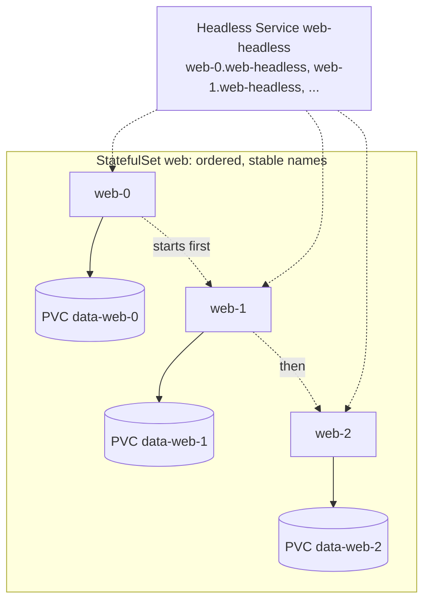

# 09 - StatefulSet

## The problem
Deployments treat Pods as **interchangeable cattle**: random names (`web-7d9f-x2k`),
shared or no storage, started in any order. That breaks databases and clustered apps
(MySQL, Kafka, etcd) that need:
- a **stable identity** (`db-0` is always the primary)
- **their own disk** that follows them after a restart
- **ordered** startup and shutdown

## What it is
A **StatefulSet** gives each Pod:
- a predictable name: `web-0`, `web-1`, `web-2`
- a stable DNS name through a **headless Service** (`web-0.web-headless`)
- its own **PVC** (from `volumeClaimTemplates`) that is re-attached when the Pod is recreated
- ordered creation (0, then 1, then 2) and reverse-order deletion

## Architecture

Each StatefulSet Pod has a stable name, a stable DNS entry and its own disk.



## Files
| File | What it shows |
|------|---------------|
| `statefulset.yaml` | A headless Service + a 3-replica StatefulSet with per-Pod storage |

## Prerequisites
A default StorageClass (on EKS: EBS CSI driver add-on). See lesson 08.

## Try it
```bash
kubectl apply -f statefulset.yaml
kubectl get pods -w                       # web-0 starts first, then web-1, then web-2
kubectl get pvc                           # one PVC per Pod: data-web-0, data-web-1, ...

# Each Pod writes its own name to its own disk
kubectl exec web-0 -- cat /usr/share/nginx/html/index.html

# Delete a Pod: it comes back with the SAME name and SAME data
kubectl delete pod web-1
kubectl get pods -w
kubectl exec web-1 -- cat /usr/share/nginx/html/index.html

# Stable DNS between Pods
kubectl exec web-0 -- getent hosts web-1.web-headless
```

## Clean up
```bash
kubectl delete -f statefulset.yaml
kubectl delete pvc -l app=web-stateful     # PVCs are NOT deleted automatically (safety feature)
```

## Key takeaways
- Use StatefulSets only when you need identity or per-Pod storage. Stateless apps belong in Deployments.
- In production, databases are often better run as managed services (RDS, etc.) unless you have a reason.
- Deleting a StatefulSet keeps its PVCs on purpose, so you do not lose data by accident.
