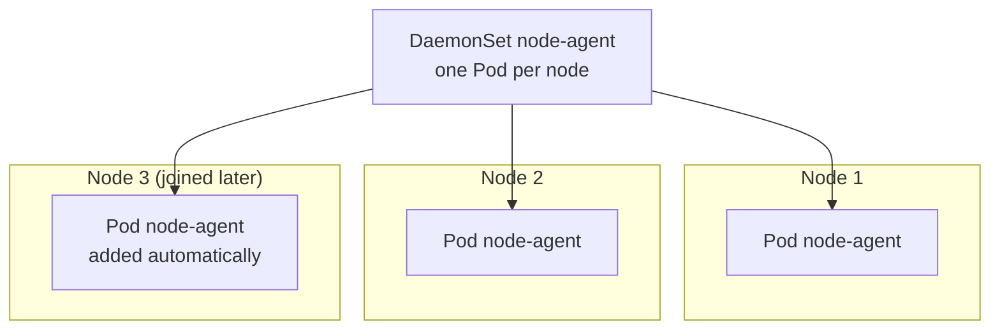

# 10 - DaemonSet

## The problem
Some software must run on **every node**: a log collector, a monitoring agent, a
network plugin. If you use a Deployment with N replicas, Kubernetes may put two on the
same node and none on another. And when a new node joins, nobody installs the agent.

## What it is
A **DaemonSet** guarantees **exactly one Pod per node** (or per matching node).
- New node joins: Pod is added automatically.
- Node is removed: Pod is garbage-collected.

Real examples: `aws-node` (VPC CNI) and `kube-proxy` in `kube-system` are DaemonSets.
Others: Fluent Bit, Prometheus node-exporter, Datadog agent.

## Architecture

A DaemonSet runs exactly one Pod on every node, including nodes that join later.



## Files
| File | What it shows |
|------|---------------|
| `daemonset.yaml` | A tiny "node agent" that prints which node it runs on |

## Try it
```bash
kubectl get daemonset -n kube-system           # see real ones first

kubectl apply -f daemonset.yaml
kubectl get pods -l app=node-agent -o wide     # one Pod per node
kubectl logs -l app=node-agent --tail=2

# Add a nodeSelector to run only on some nodes (uncomment in the YAML), then re-apply
```

## Clean up
```bash
kubectl delete -f daemonset.yaml
```

## Key takeaways
- The number of Pods equals the number of (matching) nodes; you do not set `replicas`.
- Control-plane nodes have taints; add a `toleration` if the agent must run there too.
- Use `updateStrategy: RollingUpdate` to upgrade agents node by node.
