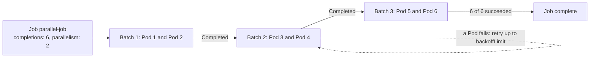

# 11 - Job

## The problem
Not every workload runs forever. A database migration, a report, a data import, or a
backup should run **once, finish, and stop**. If you run it as a Deployment, Kubernetes
sees the exited container as a failure and restarts it endlessly. A bare Pod will not
retry if the node dies.

## What it is
A **Job** runs Pods **until they complete successfully**:
- retries on failure (up to `backoffLimit`)
- can run several tasks, optionally in parallel (`completions`, `parallelism`)
- keeps the finished Pods so you can read their logs

## Architecture

A Job runs Pods until the required number have completed successfully, retrying failures.



## Files
| File | What it shows |
|------|---------------|
| `job-simple.yaml` | One Pod runs a task once |
| `job-parallel.yaml` | 6 tasks, 2 at a time |
| `job-failing.yaml` | A task that fails, to watch retries and `backoffLimit` |

## Try it
```bash
kubectl apply -f job-simple.yaml
kubectl get jobs
kubectl get pods                       # STATUS: Completed
kubectl logs job/hello-job

kubectl apply -f job-parallel.yaml
kubectl get pods -w                    # 2 run at a time, 6 in total

kubectl apply -f job-failing.yaml
kubectl get pods -w                    # new Pods keep being created, then the Job fails
kubectl describe job failing-job
```

## Clean up
```bash
kubectl delete -f .
```

## Key takeaways
- `restartPolicy` in a Job must be `Never` or `OnFailure` (never `Always`).
- `ttlSecondsAfterFinished` auto-deletes finished Jobs so they do not pile up.
- Make Jobs **idempotent**: a retry should be safe to run twice.
