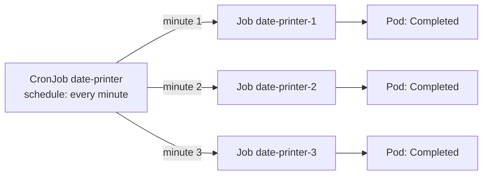

# 12 - CronJob

## The problem
You need something to happen **on a schedule**: a nightly backup, an hourly cleanup,
a weekly report. Running a cron server on a VM defeats the point of Kubernetes, and if
that VM dies the schedule dies with it.

## What it is
A **CronJob** creates a **Job** on a schedule, using the classic cron format:

```
 ┌───────── minute (0-59)
 │ ┌─────── hour (0-23)
 │ │ ┌───── day of month (1-31)
 │ │ │ ┌─── month (1-12)
 │ │ │ │ ┌─ day of week (0-6, Sunday=0)
 * * * * *
```

Examples: `*/5 * * * *` = every 5 minutes, `0 2 * * *` = every day at 02:00.

CronJob -> creates Job -> creates Pod.

## Architecture

A CronJob creates a new Job on every scheduled tick, and each Job creates a Pod.



## Files
| File | What it shows |
|------|---------------|
| `cronjob.yaml` | Prints the date every minute |

## Try it
```bash
kubectl apply -f cronjob.yaml
kubectl get cronjob
kubectl get jobs -w                  # a new Job appears every minute
kubectl logs job/<job-name>

# Pause and resume the schedule
kubectl patch cronjob date-printer -p '{"spec":{"suspend":true}}'
kubectl patch cronjob date-printer -p '{"spec":{"suspend":false}}'

# Trigger it manually without waiting
kubectl create job manual-run --from=cronjob/date-printer
```

## Clean up
```bash
kubectl delete -f cronjob.yaml
```

## Key takeaways
- Schedules use the **controller's timezone (usually UTC)**; set `timeZone:` to change it.
- `concurrencyPolicy: Forbid` stops a new run from starting while the previous one is still going.
- `successfulJobsHistoryLimit` / `failedJobsHistoryLimit` control how many old Jobs are kept.
