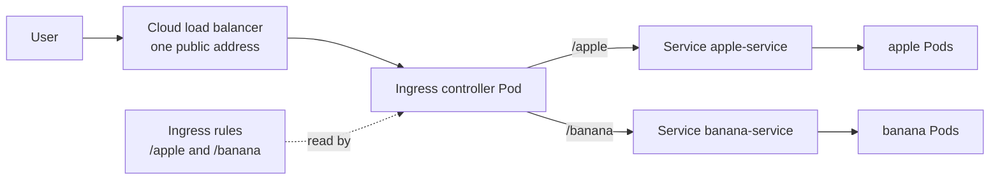

# 13 - Ingress

## The problem
You have 10 web apps. Exposing each with a `LoadBalancer` Service means **10 cloud load
balancers**, 10 public addresses and a big bill. You also cannot route by URL
(`/shop` goes to one app, `/blog` to another) or terminate TLS in one place.

## What it is
An **Ingress** is a set of **routing rules** for HTTP/HTTPS traffic entering the cluster:
one entry point, many Services behind it.

```
Internet -> Load Balancer -> Ingress Controller -> /apple  -> apple-service  -> Pods
                                                -> /banana -> banana-service -> Pods
```

The Ingress object is only the **rules**. An **Ingress Controller** (a Pod that reads
those rules) does the real work. Without a controller, an Ingress does nothing.

## Architecture

One load balancer and one controller route HTTP traffic to many Services by path or host.



## Files
| File | What it shows |
|------|---------------|
| `apps.yaml` | Two tiny apps ("apple", "banana") with their Services |
| `ingress-path.yaml` | Route by path: `/apple` and `/banana` |
| `ingress-host.yaml` | Route by hostname: `apple.example.com`, `banana.example.com` |

## Prerequisites
An Ingress controller. Options:
- **Local (minikube):** `minikube addons enable ingress`
- **Any cluster:** install **ingress-nginx** with Helm
- **EKS:** the **AWS Load Balancer Controller** (creates an ALB). Change `ingressClassName` to `alb`
  and add the annotations from the AWS docs.

Check what you have: `kubectl get ingressclass`

## Try it
```bash
kubectl apply -f apps.yaml
kubectl apply -f ingress-path.yaml
kubectl get ingress                      # wait for an ADDRESS

# Replace <ADDRESS> with the Ingress address (or localhost / minikube ip)
curl http://<ADDRESS>/apple              # -> apple
curl http://<ADDRESS>/banana             # -> banana

# Host-based routing: send a fake Host header instead of editing DNS
kubectl delete -f ingress-path.yaml
kubectl apply -f ingress-host.yaml
curl -H "Host: apple.example.com" http://<ADDRESS>/
curl -H "Host: banana.example.com" http://<ADDRESS>/
```

## Clean up
```bash
kubectl delete -f .
```

## Key takeaways
- Ingress works at **Layer 7 (HTTP)**; Services work at Layer 4 (TCP).
- Backends are normal `ClusterIP` Services; only the controller needs a public address.
- TLS is configured on the Ingress with a `tls:` block that points at a Secret.
- The newer **Gateway API** is the long-term successor, but Ingress is still everywhere.
