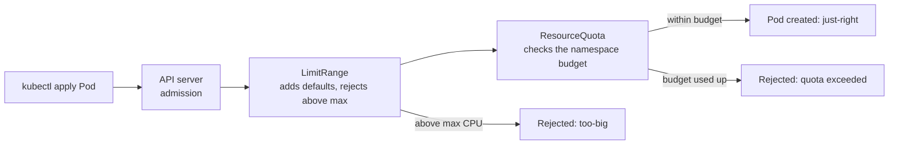

# 14 - ResourceQuota and LimitRange

## The problem
A cluster is shared. One team deploys 200 Pods and uses all the CPU, so everyone else's
apps cannot start. Or a developer forgets to set resource limits and a single Pod eats a
whole node's memory.

## What they are
| Object | Scope | Question it answers |
|--------|-------|---------------------|
| **ResourceQuota** | A whole namespace | "How much can this **team** use in total?" |
| **LimitRange** | Each Pod/container | "What is the min/max/default **per container**?" |

Together: LimitRange fills in sensible defaults, ResourceQuota enforces the budget.

## Architecture

Every Pod request passes LimitRange checks, then the ResourceQuota budget check.



## Files
| File | What it shows |
|------|---------------|
| `namespace.yaml` | A `team-a` namespace to experiment in |
| `resourcequota.yaml` | Caps total CPU, memory and Pod count |
| `limitrange.yaml` | Default and maximum size per container |
| `pods-test.yaml` | Pods that fit and a Pod that is too big |

## Try it
```bash
kubectl apply -f namespace.yaml
kubectl apply -f resourcequota.yaml
kubectl apply -f limitrange.yaml

kubectl describe quota -n team-a
kubectl describe limitrange -n team-a

# A Pod with no resources: LimitRange injects defaults
kubectl run plain --image=nginx:1.27 -n team-a
kubectl get pod plain -n team-a -o jsonpath='{.spec.containers[0].resources}'

# Try a Pod that is too big, and see the error
kubectl apply -f pods-test.yaml

# Watch quota usage go up
kubectl describe quota -n team-a
```

## Clean up
```bash
kubectl delete namespace team-a
```

## Key takeaways
- Once a quota covers CPU/memory, every Pod in that namespace **must** declare requests and limits
  (or get defaults from a LimitRange), otherwise it is rejected.
- Quotas can also cap object counts: Pods, Services, PVCs, LoadBalancers.
- These are your first tools for **multi-tenant** clusters.
