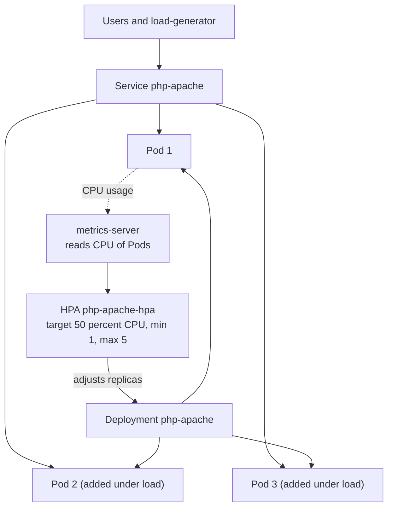

# 15 - HorizontalPodAutoscaler (HPA)

## The problem
Traffic is not constant. At night 2 Pods are plenty; during a sale you need 20. If you
set a fixed `replicas`, you either **waste money** (too many) or **fall over** (too few),
and a human has to run `kubectl scale` at 3 AM.

## What it is
An **HPA** watches a metric (usually CPU) and **adjusts the replica count** of a
Deployment automatically between a min and a max.

```
CPU above target  -> add Pods
CPU below target  -> remove Pods (slowly, to avoid flapping)
```

## Architecture

The HPA reads CPU metrics and changes the Deployment's replica count automatically.



## Files
| File | What it shows |
|------|---------------|
| `deployment.yaml` | A CPU-hungry demo web app (with CPU requests, which the HPA needs) |
| `hpa.yaml` | Scale 1 to 5 Pods, aiming for 50% CPU |
| `load-generator.yaml` | A Pod that hammers the app to create load |

## Prerequisites
**metrics-server** must be installed: `kubectl top pods` should work.
- minikube: `minikube addons enable metrics-server`
- other clusters: `kubectl apply -f https://github.com/kubernetes-sigs/metrics-server/releases/latest/download/components.yaml`

## Try it
```bash
kubectl apply -f deployment.yaml
kubectl apply -f hpa.yaml
kubectl get hpa -w                      # in terminal 1 (TARGETS shows current/target CPU)

kubectl apply -f load-generator.yaml    # in terminal 2: start the load
kubectl get pods -w                     # in terminal 3: watch Pods multiply

kubectl delete -f load-generator.yaml   # stop load; replicas fall back after ~5 minutes
```

## Clean up
```bash
kubectl delete -f .
```

## Key takeaways
- The HPA calculates utilization **as a percentage of the CPU request**, so no request means no autoscaling.
- Do **not** set `replicas` in the Deployment when using an HPA in production; let the HPA own it.
- HPA adds **Pods**. Adding **nodes** is a different tool (Cluster Autoscaler or Karpenter).
