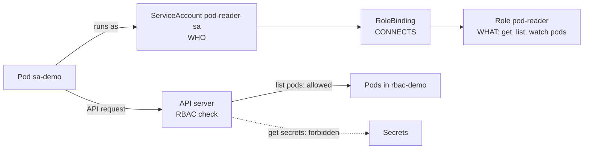

# 16 - RBAC: ServiceAccount, Role, RoleBinding

## The problem
By default, a Pod or a user either can do nothing or (if misconfigured) can do
**everything**. A monitoring app should be able to *read* Pods but never *delete* them.
An intern should see the `dev` namespace but never touch `prod`. How do you express
"who may do what, and where"?

## What they are
| Object | Answers | Analogy |
|--------|---------|---------|
| **ServiceAccount** | *Who* is this? (an identity for Pods) | An employee badge |
| **Role** | *What* is allowed? (verbs on resources, in one namespace) | A list of permissions |
| **RoleBinding** | *Who gets which* role? | Handing the badge its permissions |

Cluster-wide versions: **ClusterRole** and **ClusterRoleBinding**.

```
ServiceAccount  --(RoleBinding)-->  Role  -->  "get, list pods in namespace rbac-demo"
```

> On **EKS**, human users get in through **IAM** (access entries or the aws-auth ConfigMap),
> then RBAC decides what they may do inside Kubernetes.

## Architecture

A ServiceAccount (who) is connected to a Role (what) by a RoleBinding; the API server enforces it.



## Files
| File | What it shows |
|------|---------------|
| `rbac.yaml` | Namespace, ServiceAccount, Role (read Pods) and RoleBinding |
| `pod-with-sa.yaml` | A Pod running as that ServiceAccount |

## Try it
```bash
kubectl apply -f rbac.yaml

# Ask Kubernetes: "can this identity do X?"
kubectl auth can-i list pods   -n rbac-demo --as=system:serviceaccount:rbac-demo:pod-reader-sa   # yes
kubectl auth can-i delete pods -n rbac-demo --as=system:serviceaccount:rbac-demo:pod-reader-sa   # no
kubectl auth can-i list pods   -n default   --as=system:serviceaccount:rbac-demo:pod-reader-sa   # no

# Inside a Pod using the ServiceAccount
kubectl apply -f pod-with-sa.yaml
kubectl logs sa-demo
```

## Clean up
```bash
kubectl delete -f .
```

## Key takeaways
- RBAC is **additive**: there are no "deny" rules, you only grant.
- Follow **least privilege**: grant only the verbs and resources needed.
- Avoid binding `cluster-admin` to anything except real administrators.
