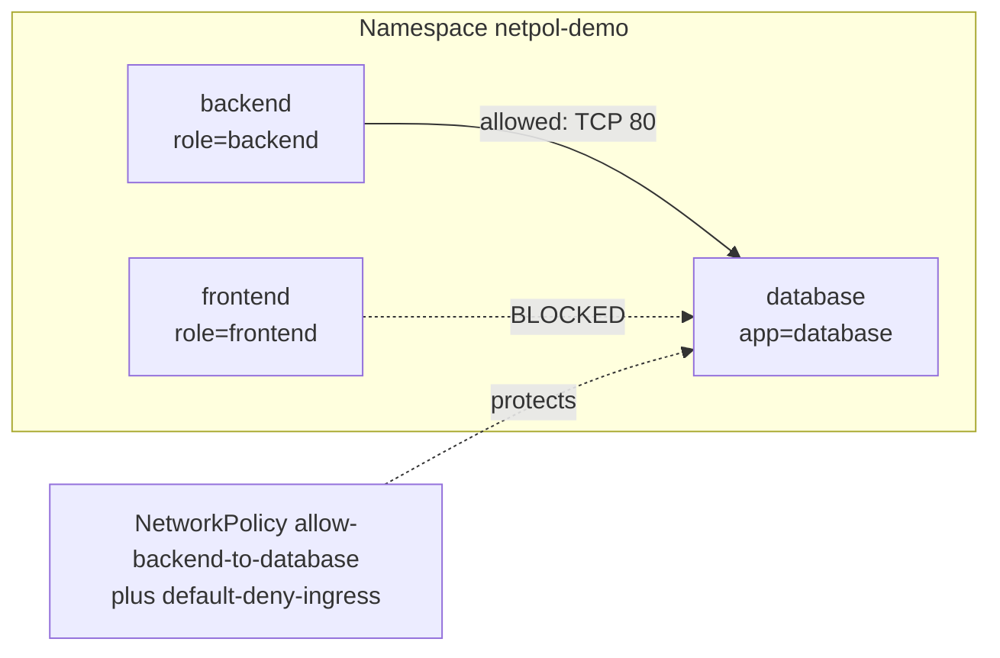

# 17 - NetworkPolicy

## The problem
By default **every Pod can talk to every other Pod** in the cluster, in any namespace.
If an attacker compromises your public frontend, they can connect straight to your
database. In real life only the *backend* should reach the database.

## What it is
A **NetworkPolicy** is a **firewall rule for Pods**, written with labels instead of IPs.
- Once any policy selects a Pod, traffic not explicitly allowed to it is **dropped**.
- Rules are `ingress` (incoming) and `egress` (outgoing).

```
frontend  --X-->  database      (blocked)
backend   ----->  database      (allowed)
```

## Architecture

A NetworkPolicy is a label-based firewall: only matching Pods may connect to the database.



## Files
| File | What it shows |
|------|---------------|
| `apps.yaml` | `frontend`, `backend` and `database` Pods with Services, in namespace `netpol-demo` |
| `deny-all.yaml` | Default deny of all incoming traffic in the namespace |
| `allow-backend-to-db.yaml` | Only `role=backend` Pods may reach the database on port 80 |

## Prerequisites
Your network plugin (CNI) must **enforce** policies. Without that the objects are accepted but do nothing.
- minikube: `minikube start --cni=calico`
- kind: use Calico or Cilium
- EKS: enable network policy support in the Amazon VPC CNI add-on (or install Calico/Cilium)

## Try it
```bash
kubectl apply -f apps.yaml
kubectl wait --for=condition=Ready pod --all -n netpol-demo --timeout=90s

# 1) Before any policy: everyone can reach the database
kubectl exec -n netpol-demo frontend -- wget -qO- -T 3 http://database
kubectl exec -n netpol-demo backend  -- wget -qO- -T 3 http://database

# 2) Lock everything down
kubectl apply -f deny-all.yaml
kubectl exec -n netpol-demo backend -- wget -qO- -T 3 http://database     # times out

# 3) Allow only the backend
kubectl apply -f allow-backend-to-db.yaml
kubectl exec -n netpol-demo backend  -- wget -qO- -T 3 http://database    # works
kubectl exec -n netpol-demo frontend -- wget -qO- -T 3 http://database    # still blocked
```

## Clean up
```bash
kubectl delete namespace netpol-demo
```

## Key takeaways
- Start with **default deny**, then open only what is needed ("zero trust" inside the cluster).
- Policies are **additive**: if two policies allow different traffic, both are allowed.
- Remember to allow **DNS** (port 53 to kube-dns) if you also restrict egress.
