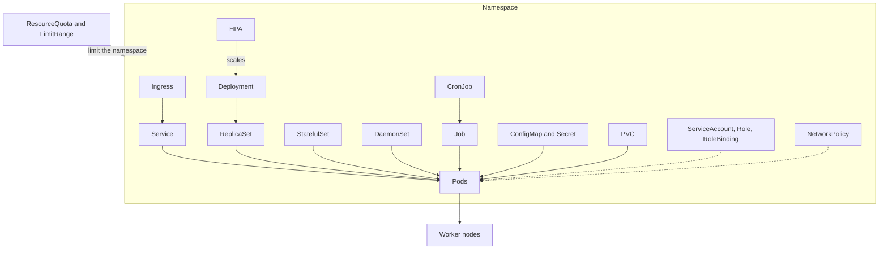

# Kubernetes Objects for Beginners

A hands-on companion for students who know the basics of Kubernetes.
Each folder covers **one Kubernetes object** and has:

- a `README.md` explaining **the problem** the object solves (the *why*) and what it is (the *what*)
- small, commented **YAML examples** you can apply and break on purpose

## How the objects fit together

Every lesson adds one piece to this picture. Arrows mean "creates, manages or feeds"; dotted arrows mean "controls or protects".



> **Diagrams not showing?** They are written in [Mermaid](https://mermaid.js.org/). GitHub and GitLab render them automatically. In VS Code install the extension **Markdown Preview Mermaid Support** and open the preview (`Ctrl+Shift+V`).

## Learning path (follow the order)

| # | Folder | Object(s) | One-line problem it solves |
|---|--------|-----------|----------------------------|
| 01 | [namespace](01-namespace) | Namespace | Teams and apps step on each other in one cluster |
| 02 | [pod](02-pod) | Pod | Something must actually run your container |
| 03 | [replicaset](03-replicaset) | ReplicaSet | A single Pod dies and nobody brings it back |
| 04 | [deployment](04-deployment) | Deployment | Updating an app without downtime, and rolling back |
| 05 | [service](05-service) | Service | Pod IPs keep changing; how do others find them? |
| 06 | [configmap](06-configmap) | ConfigMap | Config baked into images forces a rebuild per environment |
| 07 | [secret](07-secret) | Secret | Passwords should not sit in plain YAML or images |
| 08 | [storage](08-storage) | Volume, PV, PVC | Container data disappears when the Pod restarts |
| 09 | [statefulset](09-statefulset) | StatefulSet | Databases need stable names and their own disks |
| 10 | [daemonset](10-daemonset) | DaemonSet | One agent is needed on every node |
| 11 | [job](11-job) | Job | Run a task to completion, not forever |
| 12 | [cronjob](12-cronjob) | CronJob | Run a task on a schedule |
| 13 | [ingress](13-ingress) | Ingress | One load balancer per Service is costly; need routing by URL |
| 14 | [resource-management](14-resource-management) | ResourceQuota, LimitRange | One team or Pod hogs the whole cluster |
| 15 | [hpa](15-hpa) | HorizontalPodAutoscaler | Traffic changes; replicas should follow |
| 16 | [rbac](16-rbac) | ServiceAccount, Role, RoleBinding | Who is allowed to do what? |
| 17 | [networkpolicy](17-networkpolicy) | NetworkPolicy | Every Pod can talk to every Pod by default |

## Prerequisites

- A running cluster: **kind**, **minikube**, **Docker Desktop**, or **AWS EKS**
- `kubectl` configured (`kubectl get nodes` works)

## How to use each folder

```bash
cd 04-deployment
cat README.md                 # read the problem statement first
kubectl apply -f .            # apply every YAML in the folder
kubectl get all               # see what was created
kubectl delete -f .           # clean up when done
```

## Cluster add-ons some lessons need

| Lesson | Needs | Notes |
|--------|-------|-------|
| 08, 09 (PVC, StatefulSet) | A default StorageClass | On EKS install the **Amazon EBS CSI driver** add-on |
| 13 Ingress | An Ingress controller | e.g. ingress-nginx or AWS Load Balancer Controller |
| 15 HPA | metrics-server | Not installed by default on most clusters |
| 17 NetworkPolicy | A CNI that enforces policies | Calico/Cilium; on EKS enable network policy in the VPC CNI |

Each lesson's README repeats the add-on it needs.

## Golden rule for the class

> Break things on purpose. Delete a Pod, scale to zero, apply a bad image.
> Watching Kubernetes react is how the concepts stick.
